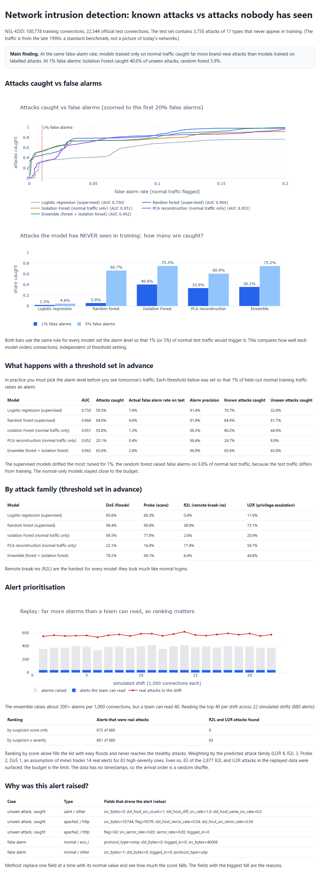

# Network Intrusion Detection: known attacks vs attacks nobody has seen

If you train a security model on yesterday's attacks, how well does it catch tomorrow's new ones? This project compares two ways of building a detector on the NSL-KDD network traffic benchmark, and the answer is more interesting than "the random forest wins".



Open `outputs/report.html` for the interactive report.

## The main finding

The benchmark's official test set contains 3,750 attacks of 17 types that never appear in the training data. That mimics real life, where a new attack is not in your training set.

At the same false-alarm rate, **models that only learned what normal traffic looks like caught far more brand-new attacks than models trained on labelled attacks.**

| Share of the never-seen attacks caught | at 1% false alarms | at 5% false alarms |
|---|---|---|
| Logistic regression (supervised) | 2.3% | 4.8% |
| Random forest (supervised) | 5.9% | 66.7% |
| Isolation Forest (trained on normal traffic only) | **40.6%** | **75.3%** |
| PCA reconstruction (normal traffic only) | 33.9% | 60.9% |
| Ensemble (forest + isolation forest) | 36.1% | 75.2% |

Both columns use the same rule for every model: set the alarm level so that 1% (or 5%) of normal test traffic would trigger it. That compares how well each model orders connections, whatever its threshold.

A second finding: **thresholds set in advance do not survive a shift in the data.** I set each alarm level so that 1% of held-out normal training traffic would trigger it. On the test traffic the random forest actually raised false alarms on 9.8% of normal connections, and logistic regression on 7.4%. The normal-only models stayed much closer to the budget (Isolation Forest 1.3%, PCA 0.4%, ensemble 2.8%). The supervised models were overconfident when the traffic changed.

The random forest is still the best model when new attack types are rare and false alarms are tolerable: it has the highest AUC (0.966) and caught 96% of DoS floods and 99.8% of port scans. Neither approach is the answer on its own, which is why the ensemble is in the table.

Remote break-ins (R2L) are the weak spot for every model. They look like normal logins, and the best of the five models caught 39% of them.

## Turning alarms into a workable queue

At the chosen settings the ensemble raises about 300+ alarms for every 1,000 connections, far more than a team can read. I replayed the test set as 22 simulated shifts of 1,000 connections and let the "team" read 40 alerts per shift.

| Ranking | Alerts that were real attacks | Stealthy attacks (R2L and U2R) found |
|---|---|---|
| by suspicion score only | 875 of 880 | 0 |
| by suspicion × severity | 861 of 880 | 83 |

Ranking by score alone fills the queue with easy floods and never reaches the stealthy attacks. Weighting by the predicted attack family (U2R 4, R2L 3, Probe 2, DoS 1, which is my assumption and would be set by a security team) gives up 14 real alerts to surface 83 high-severity ones. The queue is still tiny next to the 2,877 R2L and U2R attacks in the replayed data, so the real limit is how many alerts people can read. The data has no timestamps, so the arrival order is a random shuffle.

## Explaining an alert

Each alert comes with the fields that drove it, found by replacing one field at a time with its normal value and seeing how much the score drops. For example, an unseen `apache2` attack was flagged because of `flag=S0` and `serror_rate=0.85` (lots of half-open connections). A false alarm turned out to be an ICMP echo with an unusual size, which an analyst can dismiss in seconds. The method works with any model. It is not as rigorous as SHAP, but it is simple and easy to explain.

## How it works

- `netdet/data.py`: loads NSL-KDD, maps each attack to its family and flags attacks of types not seen in training.
- `netdet/models.py`: four detectors (logistic regression, random forest, Isolation Forest, PCA reconstruction error) sharing one preprocessing step, plus a classifier for attack family.
- `netdet/explain.py`: the explanation method.
- `evaluate.py`: trains everything, sets thresholds on held-out normal traffic, scores the official test set, builds the ensemble, runs the shift replay.
- `report.py`: builds the report.

## Run it

```bash
pip install -r requirements.txt
mkdir data
# download the two files into data/ (22 MB):
#   https://raw.githubusercontent.com/defcom17/NSL_KDD/master/KDDTrain+.txt
#   https://raw.githubusercontent.com/defcom17/NSL_KDD/master/KDDTest+.txt
python evaluate.py        # about 3 minutes
python report.py
python -m pytest tests -q # 8 tests
```

## Limits

- NSL-KDD is old (1999-era traffic) and has known flaws. It is a standard benchmark for comparing methods, not evidence about modern networks. The methods carry over, the numbers do not.
- The comparison uses one train/test split. Different seeds would move the numbers a little, so treat small gaps as ties. The 40% vs 6% gap is far larger than that.
- Severity weights are an assumption.
- The ensemble is a simple average of two models, not an optimised one.
- The simulated shifts are a random shuffle, so they say nothing about real attack timing.

Harshit Bihani
